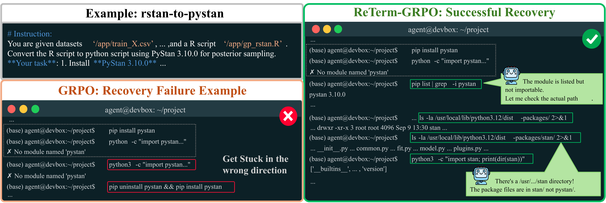
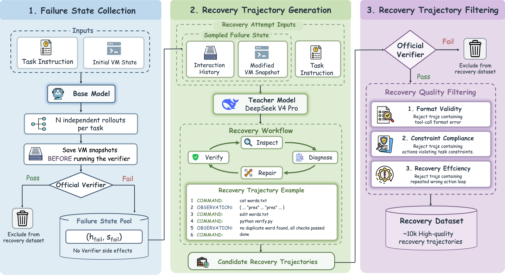
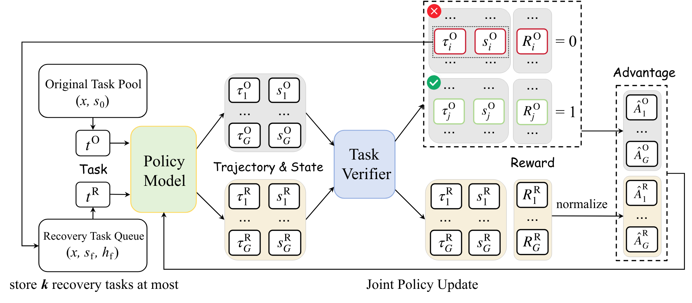

<h1 align="center">ReTerm: Recovery Training for Self-Improving Terminal Agents</h1>

<p align="center">
  <a href="https://arxiv.org/abs/2610.18484">📖 Paper</a> &nbsp;·&nbsp;
  <a href="https://huggingface.co/twothsnd/ReTerm-9B">🤗 ReTerm-9B model</a> &nbsp;·&nbsp;
  <a href="https://huggingface.co/datasets/twothsnd/ReTerm-10K">🤗 ReTerm-10K dataset</a>
</p>

## 👀 About ReTerm

We introduce **ReTerm**, a self-improving terminal agent trained to recover from errors produced during its own execution.

We construct **ReTerm-10K**, a high-quality recovery trajectory dataset generated through a dedicated data pipeline for SFT cold start. Moreover, we propose **ReTerm-GRPO**, an online RL algorithm that branches into multiple independent self-recovery attempts from the agent's own failure states. Their verifier outcomes provide group-relative learning signals, enabling the agent to self-improve through its own recovery experience.

Built on Qwen3.5-9B, **ReTerm-9B** demonstrates strong performance on challenging terminal and software engineering tasks, with generalization across out-of-domain benchmarks and different agent harnesses.

<p align="center">
  
</p>

## 🔍 Dataset

**[ReTerm-10K](https://huggingface.co/datasets/twothsnd/ReTerm-10K)** contains recovery demonstrations collected through our dedicated data pipeline. We first collect failed base-model trajectories together with the environment states they leave behind. A stronger teacher then performs recovery from these states, conditioned on the original task and inherited interaction history.

<p align="center">
  
</p>

We apply quality filters to remove unsuccessful, malformed, non-compliant, or inefficient trajectories, retaining high-quality samples for SFT cold start. These demonstrations teach the agent to continue from a faulty environment state, identify what went wrong, and repair the remaining problems. During SFT, the failed interaction history provides context, while supervision is applied only to the teacher's recovery responses.

## 🧩 ReTerm-GRPO

**ReTerm-GRPO** incorporates self-recovery into online reinforcement learning. From failure states collected during training, it samples multiple independent self-recovery attempts and computes group-relative learning signals from their verifier outcomes. Ordinary task attempts and recovery attempts optimize the same policy, with advantages computed within each group.

<p align="center">
  
</p>

The bounded recovery task queue supplies candidates for subsequent sampling. Newly collected failure states are sampled first, and the oldest entries are removed when capacity is exceeded, balancing sampling efficiency with a preference for failures generated by recent policies.

## 🏆 Performance

Built on Qwen3.5-9B, the final **ReTerm-9B** checkpoint achieves:

| Benchmark | Pass@1 |
| --- | ---: |
| OpenThoughts-TBLite | **60.6%** |
| Terminal-Bench 2.0 | **34.8%** |
| SWE-bench Verified | **58.4%** |
| AIME 2024 | **86.7%** |
| AIME 2025 | **93.3%** |
| Aider Polyglot | **20.4%** |
| SpreadsheetBench Verified | **48.8%** |

We also evaluate out-of-domain generalization and performance across agent harnesses. Further analysis examines recovery performance and unresolved errors in terminal interaction trajectories.

## 📐 Setup

Clone the repository and install the launcher:

```bash
git clone https://github.com/twothsnd/ReTerm.git
cd ReTerm
python -m pip install -e .
```

Create separate Python environments for SFT and RL, and install the corresponding dependencies:

```bash
# In the SFT environment
python -m pip install -r sft/requirements.txt

# In the RL environment
python -m pip install -r rl/requirements.txt
```

Download **ReTerm-10K** and configure the model, data, and output paths using the example profiles. RL training additionally requires a task environment supporting action execution, state preservation and restoration, and task verification through the [task adapter interface](rl/reterm_rl/task_adapter.py).

## 🚀 Training

First, perform SFT cold start:

```bash
python reterm.py sft --profile /path/to/sft.toml --run
```

Then, train with ReTerm-GRPO:

```bash
python reterm.py rl --profile /path/to/rl.toml --run
```

Two eight-GPU example profiles are provided in [`profiles/sft.example.toml`](profiles/sft.example.toml) and [`profiles/rl.example.toml`](profiles/rl.example.toml). Set the training resources, model, and task environment in the profiles. ReTerm-GRPO supports configurable `a+b` group counts, where `a` is the number of ordinary-task groups and `b` is the number of recovery groups.

## Acknowledgements

We thank the teams behind [Qwen](https://github.com/QwenLM), [veRL](https://github.com/volcengine/verl), [Megatron-Bridge](https://github.com/NVIDIA-NeMo/Megatron-Bridge), [Megatron-LM](https://github.com/NVIDIA/Megatron-LM), [DeepSpeed](https://github.com/deepspeedai/DeepSpeed), [Transformers](https://github.com/huggingface/transformers), and [vLLM](https://github.com/vllm-project/vllm) for their open-source models and training infrastructure. We also thank the [TMax](https://huggingface.co/datasets/allenai/tmax-15k-open-instruct) team for the task resources used to construct ReTerm-10K. Third-party source revisions and license information are documented in [THIRD_PARTY.md](THIRD_PARTY.md).

## Citations

If you find our work helpful for your research, please consider citing our work:

```bibtex
@article{xie2026reterm,
  title={ReTerm: Recovery Training for Self-Improving Terminal Agents},
  author={Xie, Wei and Feng, Kaituo and Fu, Shiming and Liu, Yong and Yue, Xiangyu and Zheng, Shuangjia},
  journal={arXiv preprint arXiv:2610.18484},
  year={2026},
  url={https://arxiv.org/abs/2610.18484}
}
```
